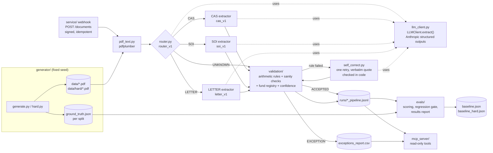

# Fund Document Extraction Agent

Turns fund PDFs (capital account statements, schedules of investments, quarterly exposure letters) into validated, structured data, and flags the documents a person still needs to look at.

## The problem

Fund operations staff receive a steady stream of documents from managers and administrators: **capital account statements** (CAS) for each investor, **schedules of investments** (SOI) listing a fund's holdings, and **quarterly letters** reporting long/short/gross/net exposure. Today the numbers are keyed in by hand. It is slow, and it is error-prone in ways that matter: a dropped minus sign, "in thousands" missed, an inception-to-date column read instead of the quarter, or a statement whose own figures don't add up and nobody notices.

This prototype reads each PDF, decides what kind of document it is, extracts the fields with a specialist prompt, checks the numbers against finance identities and sanity checks, retries once when a check fails, and puts anything still doubtful into an exceptions report with the reason. An eval harness scores every run against ground truth, a regression test guards two baselines, documents can arrive through a signed webhook, and a read-only MCP server lets Claude answer questions about the results.

All documents are **synthetic**, generated with a fixed seed. No real fund data is used.

## Architecture



| Path | What it does |
|---|---|
| `generator/` | Synthetic PDFs. `generate.py` writes the main split (several layouts per type, varied labels and number formats, a few deliberately inconsistent); `hard.py` writes the hard split in `data/hard/`. Each split has its own `ground_truth.json`. |
| `data/funds.json` | The fund registry: the ops team's master list of fund names. Not ground truth. |
| `agents/llm_client.py` | The only module that imports a provider SDK. One method: `extract(system_prompt, document_text, pydantic_model) -> pydantic_model`. |
| `agents/router.py`, `agents/extractors/` | Router and specialist extractors. Each is a versioned prompt file in `agents/prompts/` plus a pydantic schema in `schemas/`. |
| `agents/pipeline.py`, `main.py` | PDF -> text -> route -> extract -> validate -> (optional) self-correct; one JSONL log per run in `runs/`. |
| `agents/self_correct.py`, `agents/faults.py` | The one-retry self-correction loop with its code-side quote check, and seeded fault injection for measuring it. |
| `validation/` | Arithmetic rules, sanity checks, the registry check and tolerances; ACCEPTED / EXCEPTION per document; `exceptions_report.csv`. Never reads ground truth. |
| `evals/` | The only code that reads ground truth: scoring, `run_eval`, baselines, the regression check, model and self-correction comparisons, the HTML results report, and the generator for this README's numbers. |
| `mcp_server/` | Read-only MCP server (stdio) over the latest logged run plus webhook uploads. |
| `service/`, `scripts/send_doc.py` | Signed webhook service for PDF uploads, and a client that signs, posts and polls. |

## Quickstart

Requires Python 3.11+ and an Anthropic API key.

```bash
python3 -m venv .venv && source .venv/bin/activate
pip install -r requirements.txt
```

Create `.env` in the repo root (it is git-ignored). `WEBHOOK_SECRET` is only needed for the webhook service:

```bash
echo 'ANTHROPIC_API_KEY=your-key-here' > .env
echo "WEBHOOK_SECRET=$(python -c 'import secrets; print(secrets.token_hex(32))')" >> .env
```

The documents are committed. Regenerating them into a scratch folder reproduces them byte for byte (never regenerate into `data/`, which is frozen):

```bash
python -m generator.generate --out /tmp/check
```

Run the pipeline over every PDF in `data/` (calls the API, writes `runs/<timestamp>_pipeline.jsonl` and `exceptions_report.csv`):

```bash
python main.py
```

Run and score in one step (calls the API, appends metrics, git commit, model and prompt versions to the run log, then checks the baseline):

```bash
python -m evals.run_eval
```

The hard split, another model, self-correction, and a prompt version that does not exist yet (`agents/prompts/cas_v2.md`):

```bash
python -m evals.run_eval --split hard
python -m evals.run_eval --split hard --model claude-haiku-5-5
python -m evals.run_eval --self-correct
python -m evals.run_eval --prompt cas=v2
```

Run the tests, including the offline regression gate for both splits:

```bash
pytest
```

Useful offline commands (no API calls):

```bash
python -m evals.compare                      # router confusion matrix, per-field accuracy, every mismatch
python -m evals.compare --doc doc_021
python -m evals.compare_models --split hard  # models side by side
python -m evals.self_correction              # latest fault-injection runs
python -m validation.run                     # re-validate the latest run log into exceptions_report.csv
python -m evals.report                       # reports/results.html
python -m evals.readme                       # refresh the numbers in this README
```

The model is set in one place, `config.MODEL` (override with `FUND_AGENT_MODEL` or `--model`).

## Results

Generated by `python -m evals.readme` from `evals/baseline.json` and the latest run log; `tests/test_readme.py` fails if any number in this README is out of date. For everything on one page, open `reports/results.html` (built by `python -m evals.report`).

<!-- BEGIN:results -->
Dataset: 32 synthetic PDFs (10 CAS, 10 SOI, 10 LETTER, 2 UNKNOWN), 4 intentionally broken. Model `claude-sonnet-5-5`, prompts `router_v1`, `cas_v1`, `soi_v1`, `letter_v1`.

| Metric | Baseline (`evals/baseline.json`) | Latest run |
|---|---|---|
| Router accuracy | 100.0% | 100.0% (32 docs) |
| CAS field accuracy | 100.0% | 100.0% (150/150 fields) |
| SOI field accuracy | 100.0% | 100.0% (546/546 fields) |
| LETTER field accuracy | 100.0% | 100.0% (250/250 fields) |
| All fields | 100.0% | 100.0% |
| Exception precision / recall | 1.00 / 1.00 (4 caught, 0 false alarms, 0 missed) | 1.00 / 1.00 (4 caught, 0 false alarms, 0 missed) |
| UNKNOWN docs sent to exceptions |  | 2/2 |
| Tokens | | 115,158 in / 15,350 out over 62 API calls |
| Cost | | $0.38 per run, $0.0120 per doc |
| Latency | | 4.3 s mean per doc (router + extractor), 6.5 s max; wall clock not recorded in this log |

Latest run log: `runs/20261114T013741Z_pipeline.jsonl`. Baseline from `runs/20261114T013741Z_pipeline.jsonl` at commit `8540f155`. Cost uses list prices in `config.PRICING_PER_MTOK`.
<!-- END:results -->

## Hard split and model comparison

The main split turned out to be easy for the untuned prompts, so a second set of harder, realistic documents was built in `data/hard/` with its own answer key and baseline: units given only in a footer, quarter and nine-month columns side by side, management and incentive fees on one line split only in a footnote, a two-column page, an OCR text layer with the letter O for zero, a schedule spread over two pages, long exposure given only as a share of gross, short exposure in parentheses, a `K-1` tax cover letter, and one broken schedule. Every difficulty was checked to be solvable from the extracted text before any model ran.

<!-- BEGIN:hard -->
Hard split: 10 documents (5 CAS, 2 SOI, 2 LETTER, 1 UNKNOWN), 1 intentionally broken, v1 prompts unchanged.

| Measure | `claude-sonnet-5-5` | `claude-haiku-5-5` |
|---|---|---|
| Router accuracy | 100.0% | 100.0% |
| CAS fields | 100.0% (75/75) | 100.0% (75/75) |
| SOI fields | 100.0% (282/282) | 100.0% (282/282) |
| LETTER fields | 100.0% (50/50) | 100.0% (50/50) |
| Exception precision / recall | 0.50 / 1.00 | 0.50 / 1.00 |
| Tokens in / out | 36,773 / 6,056 | 36,773 / 10,024 |
| Cost (list price) | $0.1341 per run, $0.01341 per doc | $0.0087 per run, $0.00087 per doc |
| Latency per doc, mean / max | 5.1 s / 13.3 s | 5.3 s / 14.9 s |

Runs: `runs/20261114T024254Z_pipeline.jsonl`, `runs/20261114T024317Z_pipeline.jsonl` (the first is `evals/baseline_hard.json`'s source). The only exception errors are correct documents sent to review for low self-reported confidence: hard_010 (claude-sonnet-5-5 0.55; claude-haiku-5-5 0.4).
<!-- END:hard -->

Both models read every field correctly; the smaller model did it for a small fraction of the cost. The planned step of writing v2 prompts for the hard-split misses was skipped: there were no misses to target.

## Self-correction

With `--self-correct`, a document that fails a check gets one more model call. The extractor sees its first-pass values and the validator's exact finding, and the retry prompt (`agents/prompts/retry_v1.md`) forbids changing a value to make the numbers add up. Code, not the model, decides what is kept: a changed value needs a quote that appears verbatim in the PDF text and contains a number equal to the new value (allowing for thousands, millions, OCR zeros and printed dates). Everything else is reverted, and every proposed change and verdict is logged. A genuinely inconsistent document therefore stays an exception: "fixing" it would need a quote for a number the document never prints.

The model misread nothing on its own, so the loop was measured with `--inject-faults N`: after the first pass, one field is corrupted on seeded-random clean documents (a dropped digit, a flipped sign, a value off by ten, a misspelled name, a date off by a year), and the real model does the retry. The first measurement showed that faults no rule could see were never retried, so deterministic sanity checks were added: the reporting period must be one calendar quarter, fees, commitments, costs and fair values may not be negative, a letter's quarter must be well formed, and the fund name must exactly match `data/funds.json` (a near miss reports the closest registered name). Faults are chosen by the arithmetic rules alone, so the same seed injects the same faults before and after.

<!-- BEGIN:selfcorrect -->
| Split | Checks | Run | Recovered | Flagged | Undetected | Fudges rejected | Changes accepted on broken docs | Exception P / R (docs without a fault) | Extra cost of retries |
|---|---|---|---|---|---|---|---|---|---|
| main | before checks | `20261114T191454Z_pipeline.jsonl` | 5/10 | 0/10 | 5/10 | 0 | 0 | 1.00 / 1.00 | $0.1188 (+31%) |
| main | after checks | `20261114T194504Z_pipeline.jsonl` | 9/10 | 0/10 | 1/10 | 0 | 0 | 1.00 / 1.00 | $0.1698 (+44%) |
| hard | before checks | `20261114T191536Z_pipeline.jsonl` | 3/6 | 0/6 | 3/6 | 0 | 0 | 0.50 / 1.00 | $0.0848 (+63%) |
| hard | after checks | `20261114T194544Z_pipeline.jsonl` | 5/6 | 0/6 | 1/6 | 0 | 0 | 0.50 / 1.00 | $0.1023 (+76%) |

Both runs of a split use fault seed 7 and the same fault count, so the same faults are injected. Still undetected after the checks: doc_016 `quarterly_return` (sign_flip); hard_007 `unfunded_commitment` (dropped_digit).
<!-- END:selfcorrect -->

## Webhook service

`service/` is a FastAPI service for documents that arrive one at a time:

- `POST /documents` takes the raw PDF as the request body, signed with `X-Signature: sha256=<HMAC-SHA256 of the body>` using `WEBHOOK_SECRET`. Unsigned or badly signed requests get `401`, files over the size limit `413`, anything that is not a PDF `400`.
- The document id is the file's `SHA-256`. Sending the same file again returns the existing result and never reprocesses it, even after a restart.
- New files get `202` at once, then run in the background: route, extract, validate, and one self-correction retry if a rule fails.
- `GET /documents/{id}` returns the status (processing, ACCEPTED, EXCEPTION or FAILED), the extracted fields, the exception reasons and the retry history. `GET /health` reports counts.
- Results go to the same run logs (marked as the webhook split) and the same exceptions report, so the MCP server and the results report include them.

```bash
python -m service                               # http://127.0.0.1:8000
python scripts/send_doc.py data/doc_021.pdf     # sign, post, poll, print
```

<!-- BEGIN:webhook -->
Documents received so far: 2 (1 ACCEPTED, 1 EXCEPTION), logged in `runs/20261116T031556Z_pipeline.jsonl`.

- `doc_002.pdf` -> ACCEPTED
- `doc_021.pdf` -> EXCEPTION (cas_rollforward)
<!-- END:webhook -->

## Asking Claude about the results (MCP)

`mcp_server/` is a read-only MCP server over stdio, built on the official MCP Python SDK. It reads the newest main-split run that is not a fault-injection experiment, merges in webhook uploads, and uses `exceptions_report.csv` only when the file belongs to that run. It never calls a model, never writes a file and never reads ground truth. Three tools:

- `list_exceptions()`: every document in the exception queue, with each failed check (expected vs. actual, difference, tolerance) and any retry history.
- `get_document(doc_id)`: routing, every extracted field, validation status and retry log. A unique prefix of a webhook document's id also works.
- `get_fund_summary(fund_name)`: the latest capital account per investor, the latest schedule of investments, the latest letter and the documents needing review. Partial and misspelled names are matched, and the reply says how.

Add it to Claude Desktop in `~/Library/Application Support/Claude/claude_desktop_config.json` (use your own paths), then restart Claude Desktop:

```json
{
  "mcpServers": {
    "fund-docs": {
      "command": "/path/to/fund-doc-agent/.venv/bin/python",
      "args": ["-m", "mcp_server"],
      "env": { "PYTHONPATH": "/path/to/fund-doc-agent" }
    }
  }
}
```

Questions to try: "What's in the exception queue and why?", "Show me doc_021: which figures failed the roll-forward, and by how much?", "Summarise the Granite Peak fund: latest balances per investor, largest holdings, anything that needs review." Set `FUND_DOCS_LOG` or `FUND_DOCS_SPLIT=hard` in the `env` block to point it at another run.

## Design decisions

**Specialist extractors instead of one prompt.** A router picks the document type, then a prompt written for that type extracts it. Each type has its own traps: a CAS may show quarter-to-date next to inception-to-date, an SOI has sector subtotal rows that look like holdings, a letter states a negative return as `(0.5)%` or `declined 0.5%`. A dedicated prompt and schema can name those traps; one prompt covering all three would be longer and harder to change safely. It also lets each prompt be versioned and evaluated on its own (`--prompt cas=v2`), and lets UNKNOWN documents stop before any extraction.

**Structured outputs.** Every model call returns JSON constrained to a schema generated from the pydantic model, and the SDK validates it. There is no free-text parsing, no "please return JSON". Units live in the schema's field descriptions (percent units, amounts fully expanded, fees as positive numbers), so the contract is in one place.

**Provider-agnostic client.** `agents/llm_client.py` is the only file that imports the Anthropic SDK; a test enforces it. Everything else depends on `LLMClient.extract()`, so a second model is a flag and another provider is one new class. Token usage, latency and request id are recorded per call for the run log.

**Validation separate from extraction.** Extractors are told to copy figures exactly as printed and never correct them. A separate validation step then checks finance identities (CAS roll-forward, unfunded <= commitment, SOI totals, gross = long + short, net = long - short) and sanity checks (dates, signs, the fund registry). If the extractor "fixed" an inconsistent statement, the error would disappear instead of being reported. Keeping the two apart means the extractor is graded on reading, and the validator on catching. Validation never reads ground truth.

**Tolerances matched to printed precision.** A statement printed in millions to two decimals cannot add up to the dollar; one printed to the dollar should. The validator infers each document's rounding step from its own numbers and scales the tolerance to it:

<!-- BEGIN:tolerances -->
- Money sums (CAS roll-forward, SOI fair-value total): tolerance = printed rounding step x number of printed terms. The step is inferred per document from its amounts (one of 1, 10, 100, 1,000, 10,000, or 0.01 for cents; capped at 10,000). A full-unit CAS roll-forward has 7 terms, so it gets 7 units.
- `unfunded_commitment <= total_commitment` is strict: 1 unit.
- Percentage sums and exposure identities: +/-0.5 percentage points.
- Extractor or router confidence below 0.7 sends a doc to exceptions.
- Scoring tolerances: money within 0.5, percentages within 0.05.
- Regression gate: fails if any field drops more than 5 points, or router accuracy or exception recall drops at all.
<!-- END:tolerances -->

**Deterministic checks before prompt changes.** When fault injection showed what the rules could not see, the fix was code (dates, signs, a registry lookup), not a longer prompt: a check gives the same answer every time, costs nothing per document, and its failure message tells the retry exactly what to look at.

**Retries the model cannot game.** The self-correction loop accepts a change only with a verbatim quote that code verifies against the document text. The model can correct a misreading but cannot invent a number to make a statement balance.

**A separate, harder split instead of editing the test set.** `data/` is frozen so a later "improvement" cannot quietly be an easier test. New material went into `data/hard/` with its own answer key and baseline, and the regression gate checks each split against its own.

**Offline scoring from logs.** Every pipeline run writes a JSONL log with each document's route, extraction, validation result, retries and token usage. Scoring, re-validation, the comparison tables, the HTML report, the MCP server and this README are all computed from logs, never from fresh API calls. Changing a metric or a rule and re-scoring past runs is free and reproducible, and metrics are recomputed from the records rather than trusted from what a log claims.

**Regression gate.** `evals/baseline.json` and `evals/baseline_hard.json` store the accepted metrics, with the git commit, model and prompt versions that produced them. `tests/test_regression.py` reads the newest run of each split by the baseline's model and fails, naming the field and the failing documents, if any field's accuracy drops past the threshold or router accuracy or exception recall drops at all. Fault-injection runs are skipped. Tests feed it deliberately degraded logs to prove it fails.

**Read-only by construction where reading is all that's needed.** The MCP server's tools are annotated read-only, import neither the model client nor the scoring code, and a test checks that calling them writes no file.

## Limitations

- **Synthetic, text-based PDFs only.** Both splits come from one generator and have a clean text layer, even the "OCR" document. Real documents bring scans, multi-page tables, footnotes, restatements and formats nobody anticipated. Nothing here has been measured on them.
- **The tests are still too easy to tell prompt versions apart.** The untuned prompts score at the ceiling on both splits with both models. The regression gate can catch a step backwards, but this data can't show that a new prompt is better.
- **Self-reported confidence is miscalibrated in both directions.** <!-- BEGIN:confidence -->In `runs/20261114T013741Z_pipeline.jsonl`, doc_021's printed ending NAV is 14,140,000 while its roll-forward gives 13,770,000 (off by 370,000; tolerance 70,000). The extractor reported confidence 0.95, above the 0.7 threshold, so confidence alone would have accepted it; only the `cas_rollforward` rule caught it. The opposite also happens: in `runs/20261114T024254Z_pipeline.jsonl`, hard_010 (long exposure given only as a share of gross, so long, short and net must be computed) was extracted with 0 wrong fields, yet the extractor reported confidence 0.55, below the 0.7 threshold, so a correct document went to exceptions. The threshold is unchanged for now.<!-- END:confidence --> Model confidence is a weak signal for "the document itself is wrong"; the finance rules do the real work, and documents with no applicable rule rely on confidence alone.
- **Some faults are still invisible.** A flipped return sign (returns can be negative) and a shortened unfunded commitment that stays below the total pass every check; so would a misspelled manager or investor name, an SOI date off by a year, or a quarter shifted to another valid quarter. Catching them needs other sources, such as an investor master list or paid-in capital to date.
- **Derived values can't be quoted.** If a retry needs to correct a value the document only implies (long exposure computed from a share of gross), the quote check rejects it, because no printed number equals it.
- **The router prompt names capital call notices and tax documents** among its UNKNOWN examples, and two of the UNKNOWN test documents are exactly those. The router's perfect UNKNOWN score is partly helped by its prompt.
- **Tolerance is inferred from the numbers.** Validation can't see how the PDF was formatted, so it infers the rounding step from the extracted amounts. A full-unit statement whose amounts all happen to be round gets a looser tolerance (bounded by the cap), and a statement printed more coarsely than the cap allows would be flagged even when it is consistent.
- **Webhook signatures carry no timestamp.** A captured request could be replayed; the idempotent id makes a replay return the cached result rather than reprocess, but a timestamped signature would be needed before facing the internet. A normal pipeline run also rewrites `exceptions_report.csv`, dropping webhook rows from it (the run logs always keep them, and the MCP server falls back to the logs).
