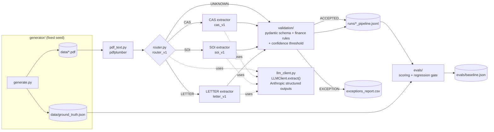

# Fund Document Extraction Agent

Turns fund PDFs (capital account statements, schedules of investments, quarterly exposure letters) into validated, structured data, and flags the documents a person still needs to look at.

## The problem

Fund operations staff receive a steady stream of documents from managers and administrators: **capital account statements** (CAS) for each investor, **schedules of investments** (SOI) listing a fund's holdings, and **quarterly letters** reporting long/short/gross/net exposure. Today the numbers are keyed in by hand. It is slow, and it is error-prone in ways that matter: a dropped minus sign, "in thousands" missed, an inception-to-date column read instead of the quarter, or a statement whose own figures don't add up and nobody notices.

This prototype reads each PDF, decides what kind of document it is, extracts the fields with a specialist prompt, checks the numbers against finance identities, and puts anything doubtful into an exceptions report with the reason. An eval harness scores every run against ground truth and a regression test guards the baseline.

All documents are **synthetic**, generated with a fixed seed. No real fund data is used.

## Architecture



| Path | What it does |
|---|---|
| `generator/` | Synthetic PDFs in several layouts per type (tables, prose, grouped, multi-column) with varied labels and number formats, a few deliberately inconsistent; writes `data/ground_truth.json`. |
| `agents/llm_client.py` | The only module that imports a provider SDK. One method: `extract(system_prompt, document_text, pydantic_model) -> pydantic_model`. |
| `agents/router.py`, `agents/extractors/` | Router and specialist extractors. Each is a versioned prompt file in `agents/prompts/` plus a pydantic schema in `schemas/`. |
| `agents/pipeline.py`, `main.py` | PDF -> text -> route -> extract -> validate; one JSONL log per run in `runs/`. |
| `validation/` | Finance rules with tolerances, ACCEPTED / EXCEPTION per document, `exceptions_report.csv`. Never reads ground truth. |
| `evals/` | The only code that reads ground truth: scoring, `run_eval`, baseline, regression check, and the generator for this README's numbers. |

## Quickstart

Requires Python 3.11+ and an Anthropic API key.

```bash
python3 -m venv .venv && source .venv/bin/activate
pip install -r requirements.txt
```

Create `.env` in the repo root (it is git-ignored):

```bash
echo 'ANTHROPIC_API_KEY=your-key-here' > .env
```

Generate the synthetic documents (already committed in `data/`; regenerating with the same seed gives byte-identical files):

```bash
python -m generator.generate
```

Run the pipeline over every PDF in `data/` (calls the API, writes `runs/<timestamp>_pipeline.jsonl` and `exceptions_report.csv`):

```bash
python main.py
```

Run and score in one step (calls the API, appends metrics, git commit, model and prompt versions to the run log, then checks the baseline):

```bash
python -m evals.run_eval
```

Try another prompt version without editing code (expects `agents/prompts/cas_v2.md` to exist):

```bash
python -m evals.run_eval --prompt cas=v2
```

Run the tests, including the offline regression gate against `evals/baseline.json`:

```bash
pytest
```

Useful offline commands (no API calls):

```bash
python -m evals.compare            # router confusion matrix, per-field accuracy, every mismatch
python -m evals.compare --doc doc_021
python -m validation.run           # re-validate the latest run log into exceptions_report.csv
python -m evals.run_eval --from-log
python -m evals.readme             # refresh the numbers in this README
```

The model is set in one place, `config.MODEL` (override with `FUND_AGENT_MODEL`).

## Results

Generated by `python -m evals.readme` from `evals/baseline.json` and the latest run log; `tests/test_readme.py` fails if this table is out of date.

<!-- BEGIN:results -->
Dataset: 32 synthetic PDFs (10 CAS, 10 SOI, 10 LETTER, 2 UNKNOWN), 4 intentionally broken. Model `claude-sonnet-5-5`, prompts `router_v1`, `cas_v1`, `soi_v1`, `letter_v1`.

| Metric | Baseline (`evals/baseline.json`) | Latest run |
|---|---|---|
| Router accuracy | 100.0% | 100.0% (32 docs) |
| CAS field accuracy | 100.0% | 100.0% (150/150 fields) |
| SOI field accuracy | 100.0% | 100.0% (546/546 fields) |
| LETTER field accuracy | 100.0% | 100.0% (250/250 fields) |
| All fields | 100.0% | 100.0% |
| Exception precision / recall | 1.00 / 1.00 (4 caught, 0 false alarms, 0 missed) | 1.00 / 1.00 (4 caught, 0 false alarms, 0 missed) |
| UNKNOWN docs sent to exceptions |  | 2/2 |
| Tokens | | 115,158 in / 15,350 out over 62 API calls |
| Cost | | $0.38 per run, $0.0120 per doc |
| Latency | | 4.3 s mean per doc (router + extractor), 6.5 s max; wall clock not recorded in this log |

Latest run log: `runs/20261114T013741Z_pipeline.jsonl`. Baseline from `runs/20261114T013741Z_pipeline.jsonl` at commit `8540f155`. Cost uses list prices in `config.PRICING_PER_MTOK`.
<!-- END:results -->

## Design decisions

**Specialist extractors instead of one prompt.** A router picks the document type, then a prompt written for that type extracts it. Each type has its own traps: a CAS may show quarter-to-date next to inception-to-date, an SOI has sector subtotal rows that look like holdings, a letter states a negative return as `(0.5)%` or `declined 0.5%`. A dedicated prompt and schema can name those traps; one prompt covering all three would be longer and harder to change safely. It also lets each prompt be versioned and evaluated on its own (`--prompt cas=v2`), and lets UNKNOWN documents stop before any extraction.

**Structured outputs.** Every model call returns JSON constrained to a schema generated from the pydantic model, and the SDK validates it. There is no free-text parsing, no "please return JSON". Units live in the schema's field descriptions (percent units, amounts fully expanded, fees as positive numbers), so the contract is in one place.

**Provider-agnostic client.** `agents/llm_client.py` is the only file that imports the Anthropic SDK; a test enforces it. Everything else depends on `LLMClient.extract()`, so adding another provider (or a two-model comparison) is one new class. Token usage, latency and request id are recorded per call for the run log.

**Validation separate from extraction.** Extractors are told to copy figures exactly as printed and never correct them. A separate validation step then checks finance identities (CAS roll-forward, unfunded <= commitment, SOI totals, gross = long + short, net = long - short). If the extractor "fixed" an inconsistent statement, the error would disappear instead of being reported. Keeping the two apart means the extractor is graded on reading, and the validator on catching. Validation never reads ground truth.

**Tolerances matched to printed precision.** A statement printed in millions to two decimals cannot add up to the dollar; one printed to the dollar should. The validator infers each document's rounding step from its own numbers and scales the tolerance to it:

<!-- BEGIN:tolerances -->
- Money sums (CAS roll-forward, SOI fair-value total): tolerance = printed rounding step x number of printed terms. The step is inferred per document from its amounts (one of 1, 10, 100, 1,000, 10,000, or 0.01 for cents; capped at 10,000). A full-unit CAS roll-forward has 7 terms, so it gets 7 units.
- `unfunded_commitment <= total_commitment` is strict: 1 unit.
- Percentage sums and exposure identities: +/-0.5 percentage points.
- Extractor or router confidence below 0.7 sends a doc to exceptions.
- Scoring tolerances: money within 0.5, percentages within 0.05.
- Regression gate: fails if any field drops more than 5 points, or router accuracy or exception recall drops at all.
<!-- END:tolerances -->

**Offline scoring from logs.** Every pipeline run writes a JSONL log with each document's route, extraction, validation result and token usage. Scoring, re-validation, the comparison tables and this README are all computed from logs, never from fresh API calls. Changing a metric or a rule and re-scoring past runs is free and reproducible, and metrics are recomputed from the records rather than trusted from what a log claims.

**Regression gate.** `evals/baseline.json` stores the accepted metrics, with the git commit, model and prompt versions that produced them. `tests/test_regression.py` reads the latest run log offline and fails, naming the field and the failing documents, if any field's accuracy drops past the threshold or router accuracy or exception recall drops at all. Tests feed it deliberately degraded logs to prove it fails.

## Limitations

- **Synthetic, text-based PDFs only.** The documents come from one generator, have a clean text layer, and share a small set of layouts. Real documents bring scans (OCR), multi-page tables, footnotes, restatements and formats nobody anticipated. Nothing here has been measured on them.
- **The test set is too easy to tell prompt versions apart.** The first, untuned prompts already score at the ceiling (see Results). The regression gate can catch a step backwards, but this data can't show that a new prompt is better. That needs harder documents (OCR noise, multi-investor statements, year-to-date columns, merged fee lines) added as a deliberate, separately committed regeneration of `data/` followed by a new baseline.
- **Self-reported confidence missed doc_021.** <!-- BEGIN:doc021 -->In `runs/20261114T013741Z_pipeline.jsonl`, doc_021's printed ending NAV is 14,140,000 while its roll-forward gives 13,770,000 (off by 370,000; tolerance 70,000). The extractor reported confidence 0.95, above the 0.7 threshold, so confidence alone would have accepted it; only the `cas_rollforward` rule caught it.<!-- END:doc021 --> Model confidence is a weak signal for "the document itself is wrong"; the finance rules do the real work, and documents with no applicable rule rely on confidence alone.
- **The router prompt names capital call notices.** `router_v1` lists capital call notices among UNKNOWN examples, and one of the synthetic UNKNOWN documents is exactly that. It is ordinary domain knowledge, but the router's perfect UNKNOWN score is partly helped by the prompt and says little about unfamiliar document types.
- **Tolerance is inferred from the numbers.** Validation can't see how the PDF was formatted, so it infers the rounding step from the extracted amounts. A full-unit statement whose amounts all happen to be round gets a looser tolerance (bounded by the cap), and a statement printed more coarsely than the cap allows would be flagged even when it is consistent. Both errors are bounded, and the second sends a document to review rather than letting one through.
